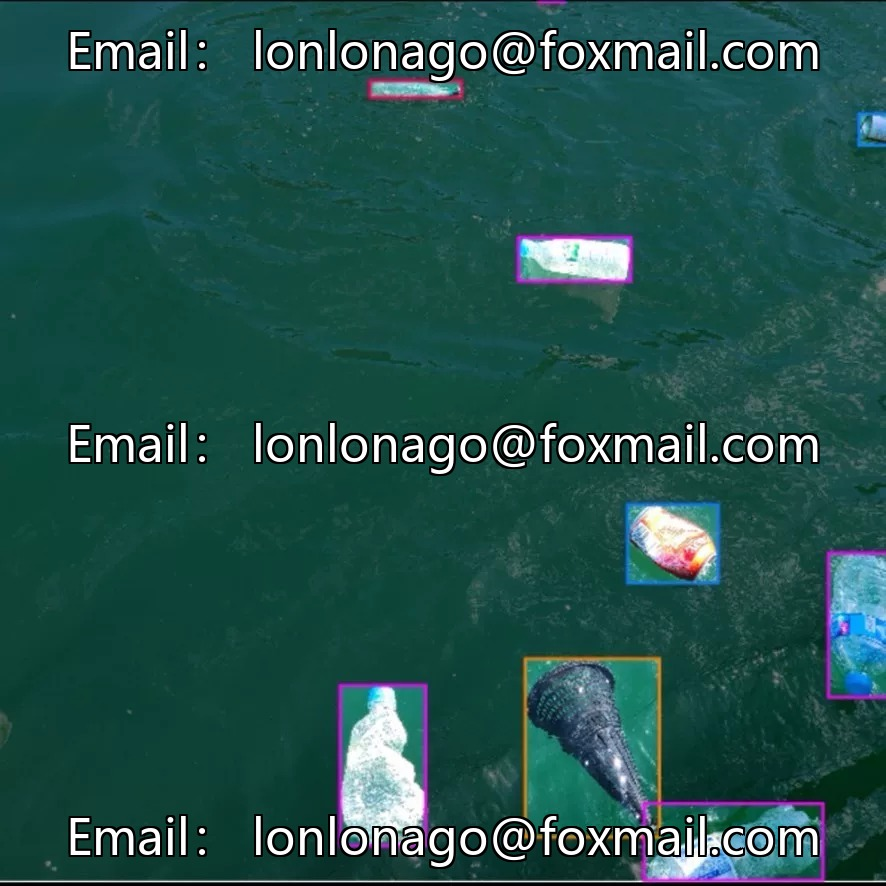
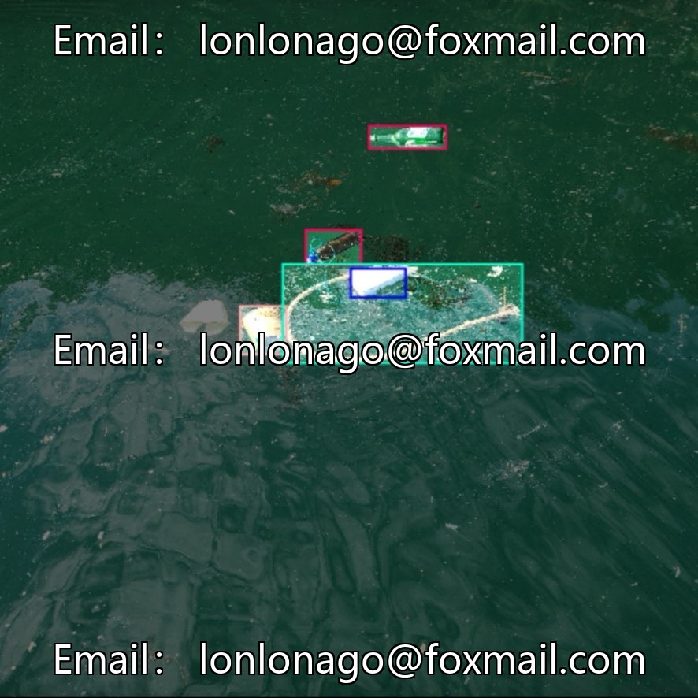
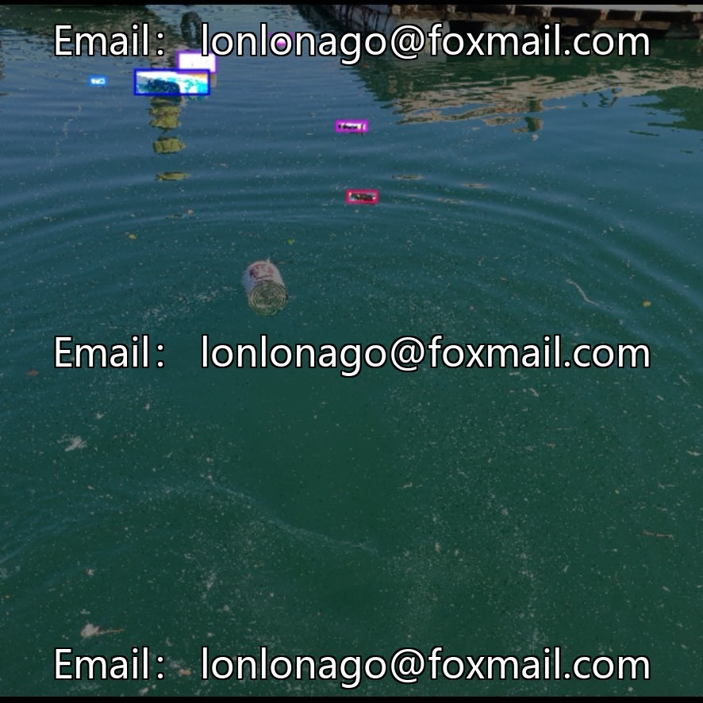
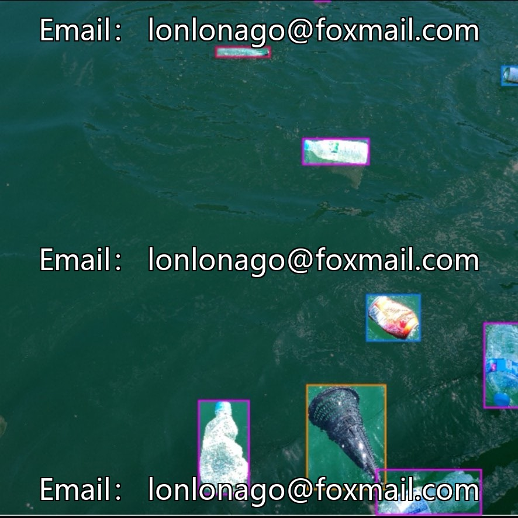
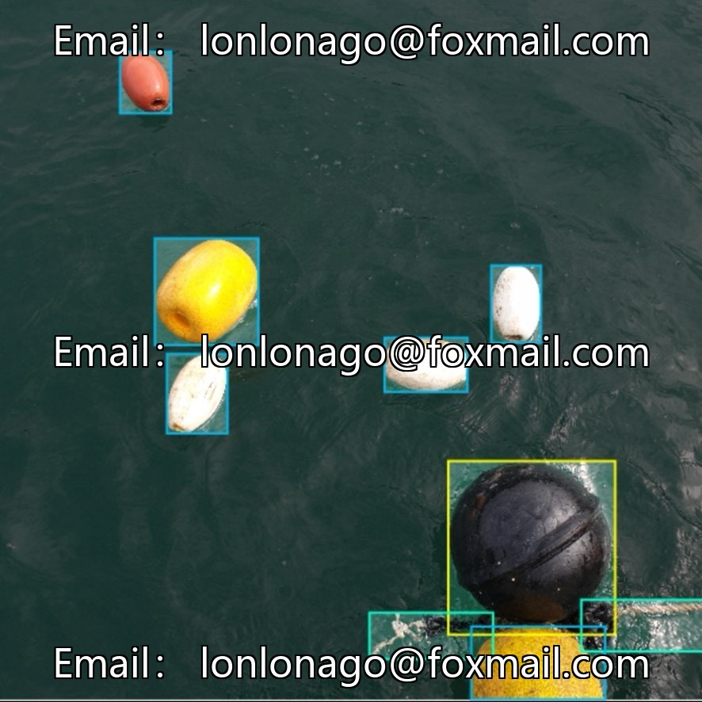

# UAV River Floating Object Detection Dataset (Multi-Category)

## Body

Drone Riverbed Floating Object Detection Dataset (Multi-Category)
Project Number: Issue No. 10383

The dataset contains 1,200 labeled images covering 11 common aquatic floating objects, suitable for scenarios such as water environment management, aquatic safety monitoring, and aquaculture management. Detailed categories, YOLO formatted annotations, directly imported for training in mainstream detection frameworks. Data covers rivers, lakes, near-shore waters, etc., supports model training and testing.

Virtual materials, once sold, are non-refundable.
Interested friends, click "I want" to proceed.

## Images

## Payment

Here is a pay link on Stripe ( https://buy.stripe.com/3cs8yP7sY87d0vu9AB ). Please contact me lonlonago@foxmail.com after funding $89, and I will send you a complete data files , thank you!

